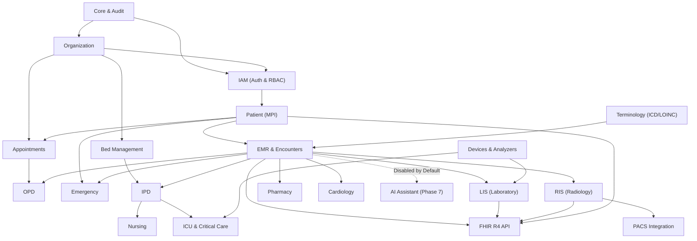

# System Architecture & Module Dependency Map
## Cardiac Hospital Gilgit — HMIS

---

## 1. Recommended Technology Stack

### 1.1 Environment-Verified Version Matrix
| Layer | Option A: Current Local PHP 8.2.12 (Immediate Start) | Option B: Upgrade Local PHP to 8.3/8.4 (Recommended Long-Term) | License |
| :--- | :--- | :--- | :--- |
| **PHP** | `8.2.12` (already installed in `C:\xampp\php`) | `8.3.x` or `8.4.x` | PHP License |
| **Framework** | **Laravel 12.x** (security fixes until Feb 24, 2027) | **Laravel 13.x** (bug fixes Q3 2027, security March 2028) | MIT |
| **UI Stack** | **Livewire 3.x** + **Alpine.js** + **Bootstrap 5.3.x** (Vite local bundle) | **Livewire 3.x / 4.x** + **Alpine.js** + **Bootstrap 5.3.x** (Vite local bundle) | MIT |
| **RBAC** | `spatie/laravel-permission` `^6.x` | `spatie/laravel-permission` `^7.x` or `^8.x` | MIT |
| **Canonical DB** | **PostgreSQL 16–18** (`18` installed locally) | **PostgreSQL 16–18** | PostgreSQL License |
| **Demo DB** | **MySQL 8.0+ / MariaDB 10.6+** (Hostinger compatible) | **MySQL 8.0+ / MariaDB 10.6+** | GPL |
| **Testing** | **Pest 3.x** or **PHPUnit 11.x** | **Pest 3.x/4.x** or **PHPUnit 11.x/12.x** | MIT / BSD-3 |
| **Static Analysis & Lint** | `larastan/larastan` + `laravel/pint` | `larastan/larastan` + `laravel/pint` | MIT |

> [!IMPORTANT]
> Regardless of whether Phase 1 boots on **Laravel 12 (PHP 8.2.12)** or **Laravel 13 (PHP 8.3+)**, all application code will target PHP 8.2+ strict types and avoid deprecated APIs so upgrading Laravel 12 → 13 once PHP 8.3+ is active is seamless.

---

## 2. Architectural Pattern: Modular Monolith

The system is structured as a **Modular Monolith** under `app/Modules/<ModuleName>/` with explicit service contracts (`Contracts/`), domain events (`Events/`), policies (`Policies/`), and module-scoped migrations/routes/views.

**Boundary Rules:**
1. Modules **must not** directly query or mutate another module's Eloquent models across write boundaries; cross-module writes go through published `Contracts` (PHP interfaces) or domain `Events`.
2. Read-only cross-module projections (e.g., Unified Patient Profile) use dedicated Read/Query Services or DTOs so schema changes stay encapsulated.
3. Controllers and Livewire components stay thin: HTTP/UI validation (`FormRequest`), policy authorization (`$this->authorize(...)`), and delegation to a transactional `Service`/`Action` class.
4. No external CDN assets. All JS/CSS/fonts/icons are bundled via Vite into `public/build/`.

---

## 3. Proposed Modular Project Folder Structure

```text
hmis/
├── app/
│   ├── Http/
│   │   ├── Controllers/          # Minimal framework entrypoints only
│   │   └── Middleware/           # Locale, timezone display, audit context, break-glass check
│   ├── Modules/
│   │   ├── Core/                 # Base contracts, ValueObjects, Pagination, System Settings, Healthcheck
│   │   ├── Organization/         # Hospital, Facilities, Departments, Wards, Units, Consultation Rooms
│   │   ├── Iam/                  # Users, Staff Profiles, Roles, Permissions, 2FA, Break-Glass Access
│   │   ├── Audit/                # Immutable audit logs, security alerts, access trails
│   │   ├── Patient/              # MPI, MRN Generator, Identifiers, Contacts, Duplicate Detection, Merge
│   │   ├── Appointments/         # Schedules, Slots, Token/Queue management
│   │   ├── Opd/                  # OPD visits, consultation queue, triage handoff
│   │   ├── Emergency/            # ER triage (ESI/CTAS), resuscitation/stabilization, unknown-patient protocol
│   │   ├── Ipd/                  # Admissions, transfers, discharges, bed-day tracking
│   │   ├── BedManagement/        # Wards, rooms, beds, occupancy state machine, cleaning/maintenance
│   │   ├── Emr/                  # Encounters, vitals, structured clinical notes, allergies, active conditions, amendments
│   │   ├── Nursing/              # MAR, nursing notes, fluid balance, care plans, handover
│   │   ├── Cardiology/           # Chest pain protocol, ECG, Echo, Cath Lab, PCI/stenting, Cardiac Surgery workflows
│   │   ├── Lis/                  # Lab catalogue, orders, barcodes, specimens, QC, results, verification
│   │   ├── Ris/                  # Imaging catalogue, orders, accession numbers, schedules, radiology reports
│   │   ├── Pacs/                 # Orthanc/OHIF adapter, StudyInstanceUID references, DICOMweb/MWL gateway
│   │   ├── Pharmacy/             # Formulary, prescriptions, dispensing, interactions, ward stock
│   │   ├── OperationTheatre/     # OT scheduling, surgical checklists, anesthesia, cardiac surgery logs
│   │   ├── Icu/                  # CCU/ICU flowsheets, ventilator/pump telemetry ingestion, bedside device registry
│   │   ├── Inventory/            # Medical/surgical stores, lot/expiry tracking, GRNs, procurement
│   │   ├── Billing/              # Tariffs, invoices, receipts, exemptions/entitlements, immutable ledger
│   │   ├── Hr/                   # Staff directory, qualifications, PMDC/PNC licenses, duty rosters
│   │   ├── Reporting/            # Operational KPIs, Bed/OPD/Lab TAT dashboards, statutory exports
│   │   ├── Notifications/        # In-app alerts, critical lab value paging, SMS/email queue (offline-safe)
│   │   ├── Fhir/                 # /api/fhir/r4 resources, transformers, validators, SMART/OAuth2 hooks
│   │   ├── Terminology/          # ICD-10, ICD-11, LOINC, UCUM versioned catalogues & mappings
│   │   ├── Devices/              # AnalyzerAdapterInterface, HL7 v2/ASTM/TCP/serial gateway registry
│   │   └── AiAssistant/          # Disabled-by-default LLM adapter, tool registry, prompt-injection guard, audit
│   ├── Providers/
│   │   └── ModuleServiceProvider.php
│   └── Support/                  # Shared deterministic helpers (CNIC formatter, MRN parser, DateTime PKT)
├── bootstrap/
├── config/
│   ├── hmis.php                  # Facility code, MRN pattern, timezone, offline mode, demo flag
│   ├── fhir.php
│   ├── terminology.php
│   └── ai.php                    # enabled=false by default
├── database/
│   ├── migrations/               # Chronological, module-prefixed or grouped migrations
│   ├── seeders/                  # Roles/permissions, departments, demo synthetic dataset (env-gated)
│   └── factories/
├── docs/                         # SRS, Architecture, ERD, ADRs, Specs, Runbooks
├── lang/
│   ├── en/
│   └── ur/                       # Prepared Urdu translation namespace
├── resources/
│   ├── css/                      # Bootstrap 5 + custom clinical theme (compiled locally)
│   ├── js/                       # Bootstrap JS + Alpine + local chart/search components
│   └── views/
│       ├── layouts/              # Persistent clinical shell, sidebar, top patient banner
│       └── modules/              # Module-namespaced Blade & Livewire views
├── routes/
│   ├── web.php                   # Loads module web routes
│   ├── api.php                   # Versioned /api/v1 & /api/fhir/r4 routes
│   └── console.php
└── tests/
    ├── Unit/
    ├── Feature/
    │   └── Modules/              # Mirroring app/Modules/*
    └── Contract/                 # FHIR, LIS analyzer, PACS contract tests
```

---

## 4. Complete 28-Module List & Dependency Map

### 4.1 Module Catalogue

| # | Module | Core Responsibility | Direct Dependencies | Implementation Phase |
| :-: | :--- | :--- | :--- | :---: |
| 1 | **Core** | Shared kernel, settings, value objects, health checks | None | Phase 0 |
| 2 | **Audit** | Immutable audit trail, security events, clinical diff log | Core | Phase 0 |
| 3 | **Organization** | Facilities, departments, units, wards, rooms | Core, Audit | Phase 1 |
| 4 | **Iam** | Auth, RBAC, staff profiles, 2FA, break-glass access | Core, Audit, Organization | Phase 0–1 |
| 5 | **Patient (MPI)** | Permanent MRN, demographics, CNIC, contacts, duplicate check, merge | Core, Audit, Iam | Phase 1 |
| 6 | **Appointments** | Clinic schedules, slots, queue tokens | Core, Organization, Iam, Patient | Phase 1 |
| 7 | **Opd** | Outpatient registration-to-consult workflow, queues | Organization, Iam, Patient, Appointments, Emr | Phase 1 |
| 8 | **Emr** | Encounters, vitals, structured notes, allergies, conditions, signed amendments | Core, Audit, Iam, Patient, Terminology | Phase 1–2 |
| 9 | **Terminology** | ICD-10, ICD-11, LOINC, UCUM versioned catalogues | Core, Audit | Phase 2 / 5 |
| 10 | **Emergency** | ER triage, rapid/no-CNIC patient intake, stabilization | Patient, Emr, Organization, Iam | Phase 2 |
| 11 | **BedManagement** | Wards, beds, availability state machine, isolation/ICU flags | Organization, Audit, Iam | Phase 2 |
| 12 | **Ipd** | Admissions, bed transfers, ward rounds, discharge | Patient, Emr, BedManagement, Organization | Phase 2 |
| 13 | **Nursing** | Nursing assessments, MAR, I/O charts, shift handovers | Ipd, Emergency, Emr, Pharmacy | Phase 2 |
| 14 | **Cardiology** | Chest pain, ECG, Echo, Cath Lab, PCI/stenting, Cardiac Surgery templates | Emr, Lis, Ris, OperationTheatre, Icu | Phase 2 / 6 |
| 15 | **Lis** | Lab catalogue, orders, barcodes, specimens, QC, verification | Patient, Emr, Terminology, Notifications, Devices | Phase 3 |
| 16 | **Ris** | Imaging catalogue, orders, accession numbers, radiology reports | Patient, Emr, Organization, Pacs | Phase 3 |
| 17 | **Pacs** | DICOM StudyInstanceUID links, Orthanc/OHIF gateway, MWL | Ris, Patient, Audit, Iam | Phase 3 / 6 |
| 18 | **Pharmacy** | Drug catalogue, prescriptions, dispensing, stock checks | Patient, Emr, Inventory, Billing | Phase 4 |
| 19 | **OperationTheatre** | OT scheduling, cardiac surgery records, WHO checklist | Ipd, Emr, Cardiology, Hr, Inventory | Phase 4 |
| 20 | **Icu** | CCU/ICU monitoring, bedside device observations | Ipd, BedManagement, Nursing, Devices | Phase 4 / 6 |
| 21 | **Inventory** | Stores, batches, expiry, procurement, GRN | Core, Organization, Audit | Phase 4 |
| 22 | **Billing** | Tariffs, charges, payments, govt exemptions, ledger | Patient, Organization, Emr, Lis, Ris, Pharmacy | Phase 4 |
| 23 | **Hr** | Staff credentials, licenses, duty rosters | Organization, Iam, Audit | Phase 4 |
| 24 | **Reporting** | Clinical & operational dashboards, TAT, bed occupancy | Read-only across operational modules | Phase 4 |
| 25 | **Notifications** | Critical value alerts, appointment/task alerts (LAN-first) | Core, Iam, Audit | Phase 3–4 |
| 26 | **Fhir** | `/api/fhir/r4` interoperability endpoints & profiles | Patient, Emr, Lis, Ris, Pharmacy, Terminology | Phase 5 |
| 27 | **Devices** | `AnalyzerAdapterInterface`, HL7 v2/ASTM/serial/monitor gateway | Lis, Icu, Cardiology, Audit | Phase 5–6 |
| 28 | **AiAssistant** | Disabled-by-default, human-approved clinical drafting & search | Core, Audit, Iam, Emr (read-only adapters) | Phase 7 |

### 4.2 Module Dependency Graph



---

## 5. MySQL Demonstration Compatibility Plan (Hostinger vs. PostgreSQL Production)

1. **Dual-Engine Safe Migrations:**
   - Avoid PostgreSQL-only DDL in shared migrations (`jsonb` → use Laravel `$table->json(...)`; `citext` → use normalized lowercase shadow columns or explicit `COLLATE`/index strategy; avoid Postgres partial index `WHERE` clauses unless wrapped in `if (DB::getDriverName() === 'pgsql')`).
   - Use `unsignedBigInteger` / `bigIncrements` primary keys and `char(36)`/`uuid` external identifiers cleanly supported by both PostgreSQL and MySQL 8+.
   - Store all timestamps in UTC `timestamp` / `datetime` columns; avoid MySQL `0000-00-00` dates and enforce strict mode (`STRICT_TRANS_TABLES`).
2. **Database-Specific Isolation:**
   - Full-text / fuzzy patient search (`pg_trgm` on PostgreSQL vs. normalized phonetic/prefix + `LIKE` / `FULLTEXT` on MySQL) isolated behind `PatientSearchRepositoryInterface` with `PostgresPatientSearchRepository` and `PortablePatientSearchRepository`.
   - MRN atomic sequence generation uses PostgreSQL `CREATE SEQUENCE` / `nextval()` when on `pgsql`, and a dedicated transactional `mrn_sequences` row-lock table (`SELECT ... FOR UPDATE`) on `mysql`/`sqlite`—preserving strict gap-free/non-recyclable monotonicity on both engines.
3. **Hostinger Shared Hosting Operational Guards:**
   - `APP_DEMO_MODE=true` seeds synthetic patients/departments/orders only when `APP_ENV !== 'production'`.
   - Queue connection uses `database` (processed via Hostinger cron `php artisan schedule:run` every minute or synchronous fallback for demo actions) so no Supervisor/Redis daemon is required in demo.
   - All Vite assets compiled before upload (`npm run build`) into `public/build/`—no Node runtime required on Hostinger.
   - Independent PostgreSQL test suite runs in CI/local against PostgreSQL 18 alongside SQLite/MySQL compatibility tests.

---

## 6. Offline Hospital LAN Architecture

- **Zero External Runtime Calls:** No Google Fonts, no jsDelivr/unpkg CDNs, no external OAuth providers required for hospital login.
- **Local DNS & TLS:** Internal hospital hostname (e.g., `hmis.chg.local`) backed by internal CA certificate over HTTPS on hospital LAN.
- **Outbound Queue Resilience:** Any optional external sync (e.g., future central health registry or remote notifications) writes to an `outbound_integration_queue` table with exponential backoff and never blocks bedside or registration transactions.
