# Database Architecture, Conventions & Initial ERD
## Cardiac Hospital Gilgit — HMIS

---

## 1. Schema & Integrity Conventions (20-Year Horizon)

1. **Primary & External Identifiers:**
   - Internal primary keys: `BIGINT` unsigned auto-increment (`id`) for high-efficiency B-tree joins across 20 years of clinical records.
   - Stable external/API identifiers: `uuid` (`CHAR(36)` / PostgreSQL `uuid`) generated via UUIDv7 (time-ordered) on every core aggregate (`patients`, `encounters`, `lab_orders`, `imaging_orders`, `clinical_notes`, `invoices`) for FHIR R4 & cross-system stability.
   - **Never use CNIC as primary key** (patients may lack CNIC in emergencies, be minors/foreigners, or have corrected CNICs).
2. **Temporal Standards:**
   - All DB columns (`created_at`, `updated_at`, `occurred_at`, `collected_at`, etc.) stored in **UTC**.
   - Application presents dates/times in `Asia/Karachi` (`PKT`, UTC+05:00) via a centralized formatter, preserving original offset metadata only if an external HL7/FHIR feed supplies one.
3. **Immutability & Clinical Safety:**
   - **No hard deletes** on patient identity, clinical notes, diagnoses, orders, lab results, imaging reports, or financial ledger entries.
   - Merged patients transition `status = 'merged'` and record `merged_into_patient_id` + an immutable `patient_merges` ledger row.
   - Finalized/signed clinical documents are immutable; edits create a new revision row (`version`, `supersedes_note_id`, `amendment_reason`, `signed_by`, `signed_at`).
4. **Concurrency Control:**
   - Critical tables (`patients`, `encounters`, `beds`, `lab_orders`, `clinical_notes`, `invoices`) carry an integer `version` column for optimistic locking.
   - Sequence generators (`mrn_sequences`, `order_sequences`) and bed allocation transitions run inside explicit `DB::transaction(...)` with pessimistic row locking (`lockForUpdate()`).
5. **Audit Trail:**
   - Every clinical, identity, authorization, break-glass, and financial mutation appends to `audit_logs` inside or immediately coupled with the transaction.

---

## 2. Initial HMIS Database ERD (Phase 0 & Phase 1–3 Foundation)

```mermaid
erDiagram
    facilities ||--o{ departments : "contains"
    departments ||--o{ wards : "manages"
    wards ||--o{ beds : "contains"
    departments ||--o{ staff_profiles : "assigns"
    users ||--o| staff_profiles : "has"
    users ||--o{ audit_logs : "performs"
    users ||--o{ break_glass_logs : "invokes"

    patients ||--o{ patient_identifiers : "has"
    patients ||--o{ patient_contacts : "has"
    patients ||--o{ patient_merges : "source_or_target"
    patients ||--o{ appointments : "books"
    patients ||--o{ encounters : "has"
    patients ||--o{ patient_allergies : "has"
    patients ||--o{ imaging_studies : "owns_pacs_ref"

    departments ||--o{ appointments : "hosts"
    staff_profiles ||--o{ appointments : "clinician"

    encounters ||--o{ clinical_notes : "documents"
    encounters ||--o{ vital_signs : "records"
    encounters ||--o{ encounter_diagnoses : "codes"
    encounters ||--o{ lab_orders : "requests"
    encounters ||--o{ imaging_orders : "requests"

    terminology_codes ||--o{ encounter_diagnoses : "references"

    lab_orders ||--o{ lab_order_items : "contains"
    lab_orders ||--o{ specimens : "collects"
    lab_test_catalog ||--o{ lab_order_items : "defines"

    imaging_orders ||--o| imaging_studies : "links_pacs"
    imaging_catalog ||--o{ imaging_orders : "defines"

    patients {
        bigint id PK
        char36 uuid UK
        varchar mrn UK
        varchar status "active|merged|deceased|inactive"
        bigint merged_into_patient_id FK
        varchar full_name
        varchar normalized_name
        varchar father_or_spouse_name
        date date_of_birth
        boolean dob_estimated
        varchar sex "male|female|other|unknown"
        varchar blood_group
        varchar cnic_normalized "nullable, indexed"
        varchar phone_primary
        boolean is_unknown_emergency
        varchar registration_type "standard|emergency|newborn"
        int version
        timestamp created_at
    }

    patient_identifiers {
        bigint id PK
        bigint patient_id FK
        varchar system "cnic|passport|sehat_card|external_mrn|legacy_mrn"
        varchar value
        varchar issuer
        boolean is_primary
        boolean verified
        timestamp valid_from
        timestamp valid_to
    }

    patient_contacts {
        bigint id PK
        bigint patient_id FK
        varchar contact_type "emergency|guardian|next_of_kin"
        varchar full_name
        varchar relationship
        varchar phone
        varchar cnic
        text address
        boolean is_primary
    }

    patient_merges {
        bigint id PK
        bigint source_patient_id FK
        bigint target_patient_id FK
        bigint merged_by_user_id FK
        varchar reason
        json snapshot_metadata
        timestamp merged_at
    }

    encounters {
        bigint id PK
        char36 uuid UK
        varchar encounter_number UK
        bigint patient_id FK
        bigint department_id FK
        bigint attending_staff_id FK
        varchar class "AMB|EMER|IMP|CARD_PROC"
        varchar status "planned|arrived|in_progress|finished|cancelled"
        timestamp started_at
        timestamp ended_at
        int version
    }

    appointments {
        bigint id PK
        char36 uuid UK
        bigint patient_id FK
        bigint department_id FK
        bigint clinician_staff_id FK
        bigint encounter_id FK
        date appointment_date
        int token_number
        varchar status "booked|checked_in|in_consult|completed|no_show|cancelled"
    }

    clinical_notes {
        bigint id PK
        char36 uuid UK
        bigint encounter_id FK
        bigint patient_id FK
        bigint author_staff_id FK
        varchar note_type "opd_consult|er_triage|cardiology_eval|discharge"
        json structured_payload
        int revision_number
        bigint supersedes_note_id FK
        varchar status "draft|signed|amended"
        bigint signed_by_user_id FK
        timestamp signed_at
    }

    encounter_diagnoses {
        bigint id PK
        bigint encounter_id FK
        bigint patient_id FK
        bigint terminology_code_id FK
        varchar coding_system "ICD-10|ICD-11"
        varchar terminology_version
        varchar code
        varchar display_name
        varchar rank "primary|secondary"
        varchar clinical_status "active|resolved|ruled_out"
        bigint recorded_by_staff_id FK
        timestamp recorded_at
    }

    lab_orders {
        bigint id PK
        char36 uuid UK
        varchar order_number UK
        bigint patient_id FK
        bigint encounter_id FK
        bigint ordered_by_staff_id FK
        varchar priority "routine|urgent|stat"
        varchar status "ordered|collected|received|in_analysis|verified|cancelled"
        timestamp ordered_at
    }

    imaging_orders {
        bigint id PK
        char36 uuid UK
        varchar accession_number UK
        bigint patient_id FK
        bigint encounter_id FK
        bigint imaging_catalog_id FK
        varchar modality "CR|CT|MR|US|ECHO|XA|ECG"
        varchar status "ordered|scheduled|in_progress|reported|verified|cancelled"
        varchar study_instance_uid "nullable until DICOM study"
        timestamp ordered_at
    }

    audit_logs {
        bigint id PK
        char36 event_uuid UK
        bigint actor_user_id FK
        varchar actor_role
        varchar action
        varchar subject_type
        bigint subject_id
        bigint patient_id "nullable"
        json old_values
        json new_values
        varchar ip_address
        varchar reason
        timestamp occurred_at
    }
```

---

## 3. Core Phase 1 Tables Summary

| Table | Module | Purpose |
| :--- | :--- | :--- |
| `facilities`, `departments`, `wards`, `beds` | Organization / BedManagement | Hospital organizational hierarchy and cardiac/ICU/general ward structure |
| `users`, `staff_profiles`, `roles`, `permissions`, `model_has_roles` | IAM | Staff authentication, PMDC/PNC registration numbers, department membership, Spatie RBAC |
| `break_glass_logs`, `audit_logs` | Audit / IAM | Emergency record access justification and immutable compliance trail |
| `mrn_sequences` | Patient | Concurrency-safe MRN sequence counter (portable across PostgreSQL & MySQL) |
| `patients`, `patient_identifiers`, `patient_contacts`, `patient_merges` | Patient (MPI) | Permanent patient identity, CNIC/external IDs, guardian/emergency contacts, merge audit |
| `appointments` | Appointments | OPD clinic bookings and token numbers |
| `encounters`, `vital_signs`, `patient_allergies`, `clinical_notes` | EMR | Unified clinical encounters, vitals, allergies, and structured versioned notes |
| `terminology_codes`, `encounter_diagnoses` | Terminology / EMR | Offline-capable ICD-10/ICD-11 catalogue and version-locked encounter diagnoses |
| `lab_test_catalog`, `lab_orders`, `imaging_catalog`, `imaging_orders`, `imaging_studies` | LIS / RIS / PACS | Phase 1–3 bridge allowing Patient Profile ordering and future PACS `StudyInstanceUID` linkage |
