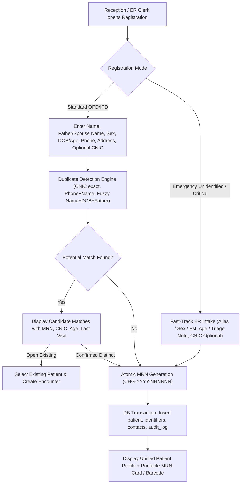

# Core Patient Registration Workflow, MRN Strategy & Unified Patient Profile
## Cardiac Hospital Gilgit — HMIS

---

## 1. Permanent MRN Generation Strategy

### 1.1 Format
**Pattern:** `{FACILITY_CODE}-{YEAR}-{SEQUENCE}`  
**Default Example:** `CHG-2026-000001`

- `FACILITY_CODE`: Configurable via `HMIS_FACILITY_CODE` (default `CHG` for Cardiac Hospital Gilgit; 2–6 uppercase alphanumeric characters).
- `YEAR`: 4-digit UTC/Asia-Karachi registration year (`2026`), supporting natural annual volume visibility while keeping global uniqueness (`UNIQUE` constraint on `patients.mrn`).
- `SEQUENCE`: Minimum 6-digit zero-padded monotonically increasing integer (`000001`–`999999`, expanding cleanly to 7+ digits if >999,999/year).

### 1.2 Invariants & Concurrency Safety
1. **Non-Recyclable:** Once generated, an MRN is never reused—even if a registration is cancelled or merged into another patient. Merged patients keep their historical MRN as an alias pointing to `merged_into_patient_id`.
2. **Immutable:** MRN cannot be edited through any UI or API endpoint after creation.
3. **Database-Atomic Generation:**
   - **PostgreSQL (`pgsql`):** Uses an atomic `nextval()` sequence per facility-year (`mrn_seq_chg_2026`) or transactional row lock inside `MrnGeneratorService`.
   - **MySQL / SQLite (`mysql` / `sqlite`):** Uses `mrn_sequences (facility_code, year, last_sequence)` inside `DB::transaction()` with `SELECT ... FOR UPDATE` (`->lockForUpdate()`).
   - **Emergency Offline Guarantee:** Zero external calls; works 100% on local database.

---

## 2. Core Patient Registration Workflow

### 2.1 Duplicate Detection Scoring Rules
Before creating a new patient, `DuplicateDetectionService` checks existing `active` patients:
1. **Hard Match (Blocking Warning — requires explicit override permission `patient.register_override_duplicate`):**
   - Exact normalized 13-digit `cnic_normalized` match.
2. **Strong Match (High-Confidence Warning):**
   - Exact `phone_primary` + similar `normalized_name` + same `sex`.
   - Exact `normalized_name` + `date_of_birth` + `father_or_spouse_name`.
3. **Fuzzy Match (Advisory List):**
   - PostgreSQL `pg_trgm` similarity / MySQL normalized token prefix + phonetic match on `normalized_name` and `father_or_spouse_name`.

### 2.2 Emergency Registration Without CNIC
- Allowed via `registration_type = 'emergency'` and optional `is_unknown_emergency = true`.
- Assigns a real permanent MRN (`CHG-2026-XXXXXX`) immediately so labs, ECG, blood bank, and cath lab orders can begin within seconds.
- Flags record `identity_verification_status = 'unverified'` so front-desk/medical records staff complete CNIC/demographics once stabilized, or merge into an existing MRN if identified later.

### 2.3 Authorized Patient Merge Workflow
- Restricted to `medical_records_officer` / `admin` (`patient.merge` permission).
- Runs in a single serializable/locked transaction:
  1. Reassigns `encounters`, `appointments`, `patient_allergies`, `clinical_notes`, `encounter_diagnoses`, `lab_orders`, `imaging_orders`, `imaging_studies`, and non-conflicting `patient_identifiers` / `patient_contacts` from `source_patient_id` to `target_patient_id`.
  2. Preserves the source MRN in `patient_identifiers` (`system = 'merged_mrn'`) so scanning an old wristband or barcode still resolves to the surviving target patient.
  3. Marks `source_patient.status = 'merged'` and `merged_into_patient_id = target_patient.id`.
  4. Writes an immutable `patient_merges` record (including JSON snapshot & reason) and an `audit_logs` entry.

---

## 3. Unified Patient Profile Screen Specification

### 3.1 Persistent Clinical Header (Always Visible Across Tabs)
- **Identity:** Full Name, Permanent **MRN** (with copy & barcode badge), Age/DOB (formatted in `Asia/Karachi`), Sex, Blood Group, CNIC (masked unless authorized), Photo thumbnail (if consented), `UNVERIFIED IDENTITY` badge if emergency.
- **Clinical Safety Strip:** Critical **Allergy Alert Banner** (red high-contrast badge if any severe allergy exists; `"No Known Allergies (NKA)"` vs `"Allergies Not Yet Recorded"`), Active High-Risk Cardiac Flags (e.g., Anticoagulation, Pacemaker/ICD, Cath Lab History).
- **Quick Action Bar (Role-Gated):**
  - `+ New OPD Visit` / `+ ER Triage`
  - `+ Order Lab` (enabled in Phase 3, stubbed action contract in Phase 1)
  - `+ Order Imaging` (enabled in Phase 3, stubbed action contract in Phase 1)
  - `Print MRN Card` / `Edit Demographics`

### 3.2 Responsive Tabbed Sections (21 Required Clinical Domains)

| Tab Group | Sections Covered | Phase Availability |
| :--- | :--- | :--- |
| **1. Overview** | Patient overview, demographics, emergency/guardian contacts, allergies summary, active conditions, recent vitals, active medications, upcoming follow-ups | Phase 1 (shell + demographics/allergies/vitals/visits) |
| **2. History & Conditions** | Medical history, allergies (detail + severity/reaction), active conditions, previous diagnoses (ICD-10/11 coded) | Phase 1–2 |
| **3. Visits & Admissions** | OPD consultations, Emergency visits, IPD admissions, discharge summaries, follow-up appointments | Phase 1 (OPD) / Phase 2 (ER, IPD, Discharge) |
| **4. Medications** | Medication history, active & historical prescriptions | Phase 2 / 4 |
| **5. Diagnostics (LIS & RIS/PACS)** | Laboratory investigations, verified laboratory reports, radiology orders, **PACS imaging studies** (`Open Study in Viewer` button enabled once `StudyInstanceUID` / PACS link exists—no PACS-specific coupling in profile UI) | Phase 3 (Orders/Reports) / Phase 6 (OHIF PACS launch) |
| **6. Cardiology & Procedures** | ECG & echocardiography, procedures and surgeries (angiography, PCI, CABG/valve) | Phase 2 / 6 |
| **7. Nursing & Vitals** | Clinical observations (vitals trends), nursing records | Phase 1 (vitals) / Phase 2 (nursing) |
| **8. Documents** | Scanned referrals, consent forms, external reports & attachments (signed local download routes) | Phase 1–2 |

### 3.3 UX & Accessibility Standards
- Desktop: Persistent collapsible left clinical navigation + sticky patient banner + tabbed workspace.
- Tablet/Mobile: Responsive Bootstrap 5 grid, offcanvas navigation, large touch targets (>=44px) for ward/ER tablets.
- Keyboard shortcuts: `/` focuses global MRN/CNIC/Name search; `Alt+N` starts New Patient registration (on reception role).
- Strict contrast ratio (>= 4.5:1) and print stylesheet (`@media print`) for MRN cards and consultation summaries.
